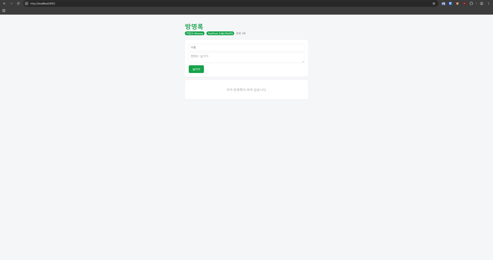

# 6주차

## 내 이미지 주소

[ghcr.io/fli-ck/guestbook](https://github.com/users/fli-ck/packages/container/package/guestbook)

## 친구 이미지 실행 결과



## Dockerfile의 각 줄이 하는 일

- `FROM`: 컨테이너의 바탕이 될 기본 환경을 정의.
- `WORKDIR`: 컨테이너 내부에서 이후에 실행될 명령어가 작업할 기본 경로를 지정
- `COPY`: 컴퓨터의 현재 디렉토리에 있는 파일이나 폴더를 컨테이너 내부의 작업 디렉토리로 복사.
- `RUN`: 빌드할 때 명령 실행
- `USER`: 다른 사용자로 컨테이너를 사용함을 설정.
- `ENV`:  `이름 = 값` 형태의 컨테이너에서 사용되는 환경 변수. `docker run -e` 로 덮어쓰기 가능.
- `EXPOSE`: 컨테이너 내에서 사용할 포트 번호. 어떤 포트 사용할 예정인지 알려주는 정보.
- `CMD`: 컨테이너를 시작할 때 실행할 명령.

## 빌드 캐시가 동작한 로그 (CACHED)

[build-cache.log](./build-cache.log) 참고

```
#0 building with "default" instance using docker driver

#1 [internal] load build definition from Dockerfile
#1 transferring dockerfile: 534B done
#1 DONE 0.0s

#2 [internal] load metadata for docker.io/library/python:3.12-slim
#2 DONE 0.7s

#3 [internal] load .dockerignore
#3 transferring context: 120B done
#3 DONE 0.0s

#4 [1/6] FROM docker.io/library/python:3.12-slim@sha256:a6e34c598f2467ed0e9a8d349809fcd8b5c603269512df273a0bb1784edc11b1
#4 resolve docker.io/library/python:3.12-slim@sha256:a6e34c598f2467ed0e9a8d349809fcd8b5c603269512df273a0bb1784edc11b1 0.0s done
#4 DONE 0.0s

#5 [internal] load build context
#5 transferring context: 235B done
#5 DONE 0.0s

#6 [2/6] WORKDIR /app
#6 CACHED

#7 [3/6] COPY requirements.txt .
#7 CACHED

#8 [5/6] COPY . .
#8 CACHED

#9 [4/6] RUN pip install --no-cache-dir -r requirements.txt
#9 CACHED

#10 [6/6] RUN useradd -m appuser
#10 CACHED

#11 exporting to image
#11 exporting layers done
#11 exporting manifest sha256:17d1a7448af4bba091ccbae41296e85fee230548c9a78ad0de73d90f3385b89d done
#11 exporting config sha256:cec47043939d1e1e25ec82ef275ae026c9e621b5c7c8d4aff9c49b50e3c0c8ca done
#11 exporting attestation manifest sha256:f7d13f11f328563d906338a2697d0958c688bd02986bba2ada690e28882504dc 0.0s done
#11 exporting manifest list sha256:64cfc4745951b76bd31b447f95939b19fc2e07a3c67658fecdac820480c93c6a
#11 exporting manifest list sha256:64cfc4745951b76bd31b447f95939b19fc2e07a3c67658fecdac820480c93c6a 0.0s done
#11 naming to docker.io/library/guestbook:v1.2 done
#11 unpacking to docker.io/library/guestbook:v1.2 done
#11 DONE 0.1s
```

## 설정을 넣는 세 가지 방법(`코드` / `ENV` / `-e`)의 차이

- 코드: 코드 내 변수 기본값을 수정하는 방식으로 설정, 완전히 바꾸기 위해서는 코드 수정 후 재빌드가 필요.
- `ENV`: 이미지 빌드 시점에 사용할 환경 변수 기본값을 설정, 완전히 바꾸기 위해서는 Dockerfile 수정 후 컨테이너 재빌드가 필요.
- `-e`: 컨테이너 실행 시점에 사용할 환경 변수 기본값을 설정, 완전히 바꾸기 위해서는 컨테이너만 다시 `rm` 하고 환경 변수값만 변경해 올리면 해결.
