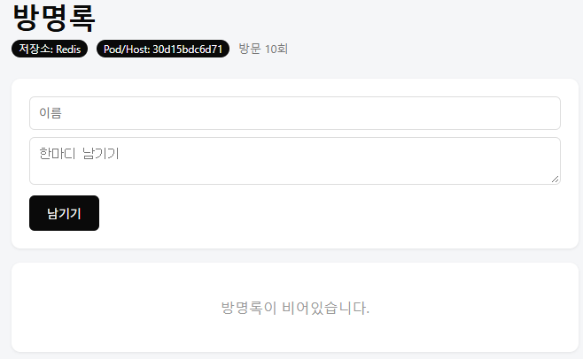
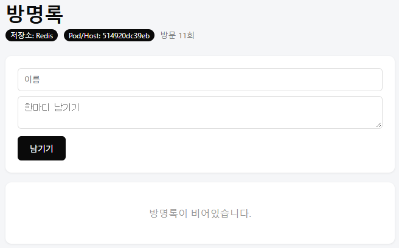
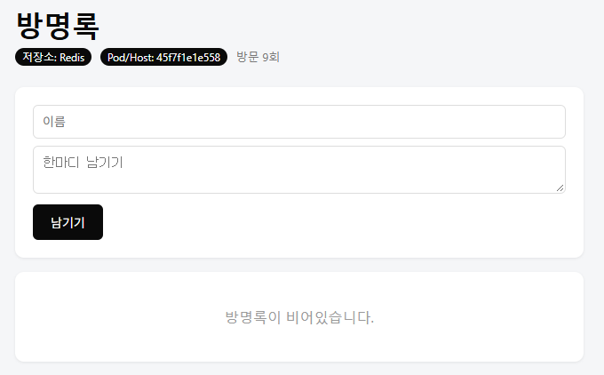

# 7주차

[../guestbook/compose.yml](../guestbook/compose.yml) 참고.

## `docker compose ps` 결과

### 일반 실행

```
NAME                IMAGE            COMMAND                  SERVICE   CREATED         STATUS                   PORTS
guestbook-nginx-1   nginx:alpine     "/docker-entrypoint.…"   nginx     3 minutes ago   Up 2 minutes             0.0.0.0:8080->80/tcp, [::]:8080->80/tcp
guestbook-redis-1   redis:7-alpine   "docker-entrypoint.s…"   redis     3 minutes ago   Up 2 minutes (healthy)   6379/tcp
guestbook-web-1     guestbook-web    "python app.py"          web       2 minutes ago   Up 2 minutes (healthy)   5000/tcp
```

### `--scale web=3`

```
NAME                IMAGE            COMMAND                  SERVICE   CREATED          STATUS                    PORTS
guestbook-nginx-1   nginx:alpine     "/docker-entrypoint.…"   nginx     12 seconds ago   Up Less than a second     0.0.0.0:8080->80/tcp, [::]:8080->80/tcp
guestbook-redis-1   redis:7-alpine   "docker-entrypoint.s…"   redis     12 seconds ago   Up 11 seconds (healthy)   6379/tcp
guestbook-web-1     guestbook-web    "python app.py"          web       12 seconds ago   Up 6 seconds (healthy)    5000/tcp
guestbook-web-2     guestbook-web    "python app.py"          web       12 seconds ago   Up 5 seconds (healthy)    5000/tcp
guestbook-web-3     guestbook-web    "python app.py"          web       12 seconds ago   Up 5 seconds (healthy)    5000/tcp
```

## `--scale web=3` 결과







## `down` 후 `up`과 `down -v` 후 `up`의 차이

`compose.yml` 에 `volumes`을 Docker volume으로 설정했다는 가정 아래에:

`down` 후 `up`은 Volume을 지우지 않기 때문에 Persistent data가 유지되어 컨테이너 재시작 이후에도 재시작 이전의 데이터가 보인다.

`down -v` 후 `up`은 Volume을 지우기 때문에 Persistent data가 완전히 날아가서 컨테이너 재시작 이후에 재시작 이전의 데이터가 없다.

## `.env`를 Git에 올리지 않는 이유

기본적으로 `.env` 파일 자체는 컨테이너 내에서 사용되는 환경 변수들을 외부 파일로 빼낸 것에 불과하여 왜 사용하는지를 모를 수 있다.

프로덕션에서도, 비밀번호나 시크릿 키와 같은 운영상에서 매우 중요하고 민감한 크레덴셜은 별도의 파일로 분리해야한다. 보안면에서 중대하다.

이러한 자료들은 코드 내에서 하드코드 되지 않도록 하며, 변경사항 목록에서도 추적되지 않도록 ignore 처리하도록 하는것이다.

단순히 `키 = 값` 형태를 유지하고 있어 작성하기도 편리하다. 가장 표준적인 방법이며, 다양한 배포 환경에서도 `.env` 파일만 직접 작성해주면 환경 변수값의 차이만 가진 채로 바로 배포할 수 있다.

원한다면 Git에 올려도 된다. 다만 이로 인해서 봇이나 악성 사용자로 인해 강냉이 털리는 일은 아무도 책임질 수 없다.
